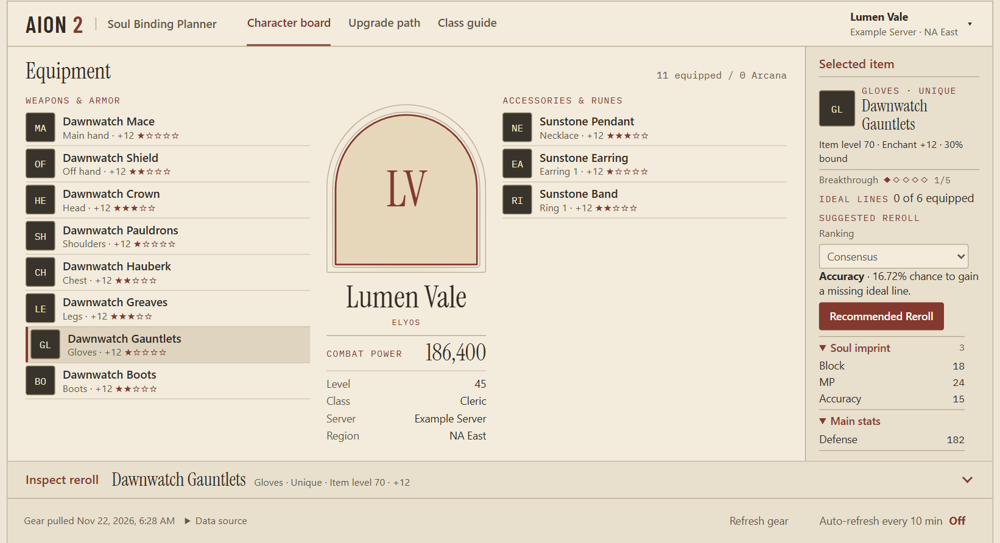
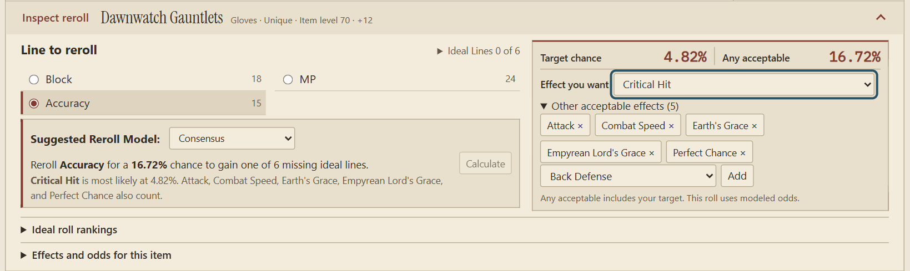
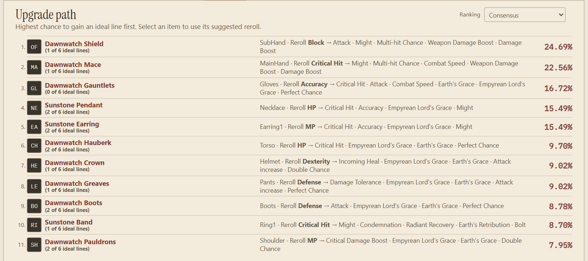
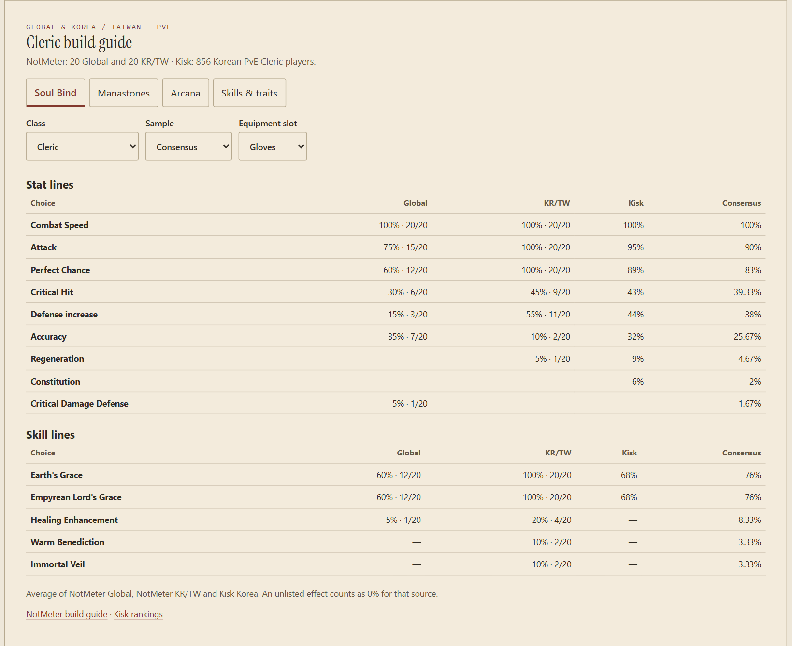

# AION 2 Character Folio

Character Folio helps AION 2 Global players decide **which piece of gear to reroll, which line to replace, and what to keep if it lands**. It reads your equipped gear from the public armory and uses the stat and skill pools for each item to calculate your odds. You can follow the PvE rankings for your class or set your own priorities.

**[Download the Windows app](../../releases/latest/download/Aion2CharacterFolio.exe)** · [Release notes and source downloads](../../releases/latest)

Open the executable on 64-bit Windows with Microsoft Edge WebView2 Runtime installed. Enter your character name, choose your Global region, then select the result on your server. The app starts with an empty roster and keeps the characters you add on your PC.

## Read your equipment at a glance

The **Character board** shows your weapons, armor, accessories, runes and Arcana around your character’s level, class and combat power. Select a piece to see its enchantment, breakthrough progress, and equipped Soul Binding effects. The item details also show main stats and socket contents when the armory reports them. **Ideal Lines** counts how many of the effects preferred by your selected ranking are already on the item.



*All four screenshots use the released interface with an invented Cleric named Lumen Vale and an illustrative loadout.*

## Decide what counts as a successful reroll

Open **Inspect reroll** on a piece of equipment. Select the line you would replace, choose the effect you want most, and add any alternatives you would keep. The two percentages answer different questions about the same roll.

| On the example gauntlets | What the number means |
| --- | --- |
| **Target chance · 4.82%** | The chance of rolling **Critical Hit** on the next attempt. |
| **Any acceptable · 16.72%** | The chance of rolling **any one** of Critical Hit, Attack, Combat Speed, Earth’s Grace, Empyrean Lord’s Grace or Perfect Chance. |



The example model recommends replacing **Accuracy**. To see how it reached that decision, expand **Ideal roll rankings** to review the preferred effects or **Effects and odds for this item** to compare each effect’s base chance with its chance on your current piece. The calculation excludes every effect already on the item for the current draw, including the outgoing line. After you roll in-game, refresh your gear to calculate from the new set of effects.

## Pick the next piece to work on

**Upgrade path** compares eligible pieces by the chance that one reroll will add a missing ideal line. Each row shows the proposed outgoing effect, the replacements worth keeping, and their combined chance. Select an item name to open its inspector with that plan loaded.

In the example loadout, the shield comes first at **24.69%**, followed by the mace at **22.56%** and the gauntlets at **16.72%**. Use those odds when your goal is to gain a preferred line in one attempt. Estimating a damage or combat-power increase would require a separate calculation.



## Choose what “ideal” means for your build

The **Class guide** covers Assassin, Brawler, Chanter, Cleric, Gladiator, Ranger, Sorcerer, Spiritmaster and Templar. Browse **Soul Bind**, **Manastones**, **Arcana**, or **Skills & traits**, then filter by class, sample, and slot or skill. Coverage varies by class and source. Brawler has Korea/Taiwan and Kisk data in this version.

For Soul Binding, **Consensus** averages the usage percentages from NotMeter Global, NotMeter Korea/Taiwan and Kisk Korea, with equal weight and zero for an unlisted effect. For example, the Cleric glove guide gives **Perfect Chance** an **83% Consensus score** from source values of 60%, 100% and 89%. That score describes how often players chose the effect. The reroll inspector uses the item’s outcome weights to calculate how often you can roll it.



To follow a particular source, change **Suggested Reroll Model** in the inspector. To tailor it to your build, open **Ideal roll rankings → Create Custom Ranking**, name the ranking, and pin your effects in priority order. Consensus fills the remaining places. You can copy a ranking between matching ring, earring or bracelet slots, then edit each copy independently. The upgrade path can use one model across your loadout or each slot’s saved ranking.

## Switching characters and refreshing gear

**Quick switch** reopens a saved character with their last successful gear pull. **Gear pulled** shows the age of that snapshot. Use **Refresh gear** after an in-game change, or enable **Auto-refresh every 10 min** for the active character. If a refresh fails, you can keep planning from the last successful pull.

## Privacy and network use

The first launch opens with an empty roster. A search sends the entered name and region to the official armory. Selecting or refreshing a character requests their public profile and equipment, and portraits and item images may load from game CDNs. Quick switch restores previously fetched gear on the same PC.

The desktop host keeps roster data in IndexedDB and settings in the private WebView2 profile under `%LOCALAPPDATA%\Aion2CharacterFolio\Profile`. **Remove Saved Character** removes a roster entry. GitHub receives no gameplay or roster data from the app. Contributors should use invented examples for bug reports and redact screenshots.

## Building from source

Use Windows x64, Windows PowerShell 5.1 or later, Python 3.9 or later, and the Windows .NET Framework 4.x C# compiler. Run this from the source directory:

```powershell
.\build.ps1
```

The build prepares the bundled class and item tables, downloads WebView2 SDK 1.0.1264.42 from NuGet on the first build, verifies the hashes of its three components, and writes `build\Aion2CharacterFolio.exe`. The runtime is a separate Windows prerequisite. [Microsoft WebView2 Runtime](https://developer.microsoft.com/microsoft-edge/webview2/)

For an offline build, pass `-SdkDirectory` with the extracted SDK. Place the two managed DLLs in `lib\net45\` or in its root and the x64 loader in `runtimes\win-x64\native\`. Use `-Python` to select a Python executable. All generated files stay under `build\`.

## Project map

| Location | Purpose |
| --- | --- |
| `desktop/Desktop.cs` | Windows host, embedded asset handling and allowlisted armory requests |
| `web/ui/` and `web/index.html` | Character search, gear inspector, quick switching and class guides |
| `web/engine/engine.js` | Effect rankings and probability calculations |
| `reference/` | Editable aggregate class statistics and item pool weights |
| `prepare.py` and `build.ps1` | Assemble the reference tables and compile the desktop executable |
| `tests/` | First-run, search, calculation and local-save regression checks using invented inputs |

### Running the interface checks

With Node.js, Chrome and Python available, run:

```powershell
python prepare.py
npm install --no-save --package-lock=false playwright@1.62.1
node tests/first-run.cjs
```

The test intercepts armory requests and creates a temporary browser profile. It checks empty onboarding, a lookup with invented data, reroll recommendations, model switching, all nine classes, persistence across reloads, and recovery after a failed refresh.

## Licensing and sources

The original application code, build scripts, tests and documentation use the [MIT License](LICENSE). The bundled fonts use the [SIL Open Font License](web/ui/fonts/OFL.txt). The separate WebView2 SDK carries its [Microsoft license](licenses/WebView2.txt).

AION 2 is a game by NCSOFT. Character Folio is an independent fan project. Game names and third-party materials belong to their respective owners. The aggregate reference snapshot draws on [NotMeter](https://notmeter.com/?view=setup-guide), [Kisk](https://kisk.app/scoring) and [Aion2.gg](https://aion2.gg/tools/soul-imprint). Source links are preserved with the tables.
